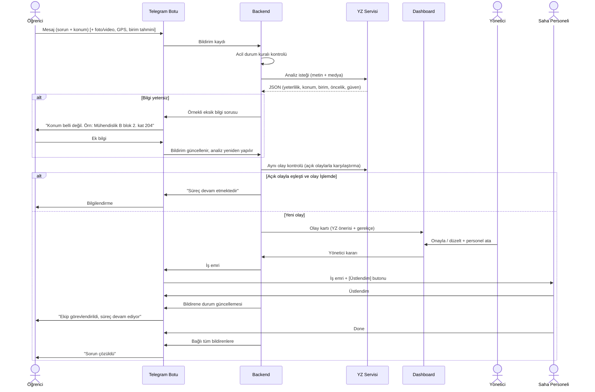
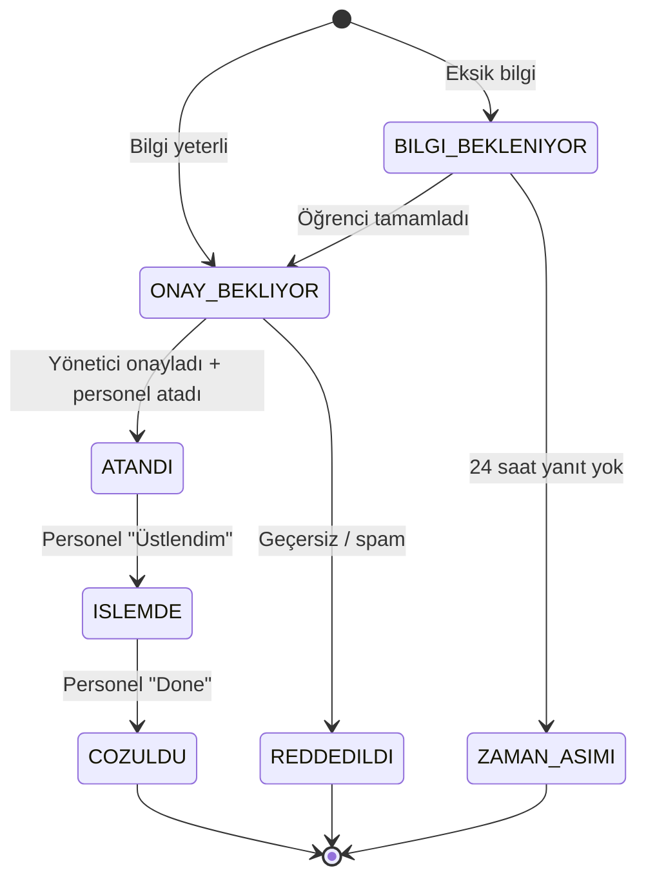
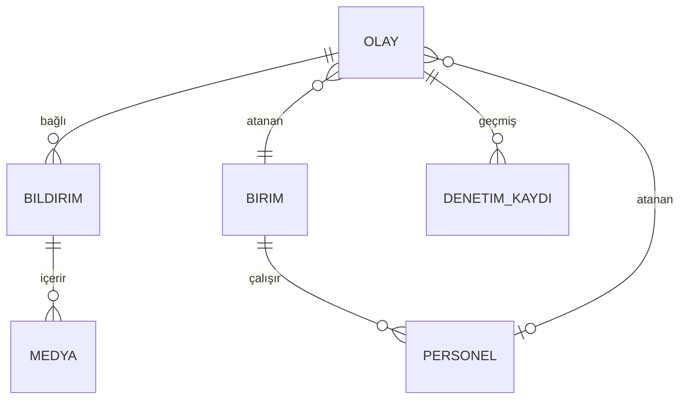

# Kampüs Arıza Asistanı — Proje Dokümanı

> **AI-Deathon – ICAAD 26** | Selçuk Üniversitesi Alaeddin Keykubat Kampüsü
> Geçici proje adı: **Kampüs Arıza Asistanı** (değiştirilebilir)
> Prototip ortamı: Google Antigravity

---

## 1. Özet

Kampüste arıza yaşayan öğrenciler, sorunu Telegram üzerinden kendi gündelik diliyle yazar. İsterlerse fotoğraf, video veya konum da ekleyebilirler. Yapay zekâ bu dağınık anlatımı teknisyenin anlayacağı yapılandırılmış bir **iş emrine** çevirir: konum, belirti, olası neden, önerilen birim ve öncelik. Bilgi eksikse öğrenciye örnekli bir geri dönüş yapar.

İş emri bir yönetici paneline (dashboard) düşer. **Son kararı her zaman yönetici verir.** Onaylanan iş Telegram üzerinden saha personeline iletilir. Personel işi üstlendiğinde, aynı sorunu bildiren yeni öğrencilere otomatik olarak "süreç devam etmektedir" yanıtı gider. İş çözüldüğünde personel **Done** ile süreci kapatır ve sorunu bildiren herkes bilgilendirilir.

---

## 2. Problem

### 2.1 Problem tanımı

Kampüste arıza yaşayan kişiler teknik dili bilmediği için sorunu teknisyenin anlayacağı şekilde anlatamıyor. Bu yüzden bildirimler ya hiç yapılmıyor ya da eksik ve yanlış bilgiyle yanlış birime gidiyor. Aynı sorun defalarca bildiriliyor ve bildiren kişi sürecin nerede olduğunu bilmiyor.

### 2.2 Temel sorun: uzmanlık boşluğu

Mevcut kategori seçmeli formlar, kullanıcının sorunu zaten teşhis etmiş olmasını bekler ("ağ / elektrik / tesisat"). Oysa öğrencinin bildiği şey yalnızca belirtidir:

| Öğrencinin anlatımı | Teknisyenin ihtiyaç duyduğu bilgi |
|---|---|
| "Labda net yok ama telefonum çekiyo" | Kablosuz ağ çalışıyor, sorun kablolu ağda ve tek odayla sınırlı. Birim: Bilgi İşlem |
| "Tavanda kahverengi leke var, damlıyo galiba" | Olası su sızıntısı. Birim: Yapı İşleri (tesisat) |
| "Işıklar gitti, modem de kapandı" | Kök neden elektrik kesintisi. Birim: Yapı İşleri (elektrik) |

### 2.3 Varsayımlar (doğrulanacak)

- Öğrencilerin büyük kısmı arızayı hangi birime bildireceğini bilmiyor.
- Aynı arıza birden fazla kişi tarafından farklı kanallardan bildiriliyor.
- Bildiren kişi sürecin durumu hakkında geri bildirim almıyor.
- Birim adları ve görev tanımları üniversitenin resmî sitesinden doğrulanacak. Bu dokümandaki birim listesi bir taslaktır (bkz. Bölüm 6.2).

---

## 3. Yapay Zekânın Rolü

### 3.1 YZ'nin yaptığı işler

1. **Çok modlu anlama:** Serbest metin, fotoğraf ve videodan (ilk karesinden) sorunun ne olduğunu anlamak. Kullanıcının cihazın veya sorunun adını bilmesi gerekmez.
2. **Gündelik dilden teknik dile çeviri:** Belirtilerden olası nedeni ve sorunun kapsamını çıkarmak.
3. **Bilgi yeterliliği kontrolü:** Sorun ve konum bilgisi yeterli değilse eksik olanı tespit edip öğrenciye örnekli bir soru üretmek.
4. **Konum çıkarma:** "Mühendislik B blok 2. kat 204" veya "kütüphane girişindeki tuvalet" gibi ifadeleri yapılandırılmış konuma dönüştürmek.
5. **Birim ve öncelik önerisi:** Gerekçesi ve güven skoruyla birlikte.
6. **Aynı olay tespiti:** Yeni bildirimin açık bir olayla aynı sorun olup olmadığına karar vermek. Karar konum, kategori ve anlam üzerinden verilir.

### 3.2 YZ'nin YAPMADIĞI işler (bilinçli tasarım kararı)

| İş | Nasıl yapılır | Neden |
|---|---|---|
| Son birim ve öncelik kararı | Yönetici | İnsan denetimi zorunlu |
| Acil durum tespiti (duman, gaz kokusu, kıvılcım, elektrik çarpması, su baskını) | Sabit anahtar kelime kuralı, YZ'den önce çalışır | Öngörülebilir ve güvenilir olmalı |
| Durum takibi ve bildirimler | Klasik yazılım (durum makinesi) | YZ gerektirmez |
| Personel ataması | Yönetici | Operasyonel karar |

### 3.3 Jüri için tek cümle

> "Form, kullanıcının sorunun ne olduğunu bilmesini bekler. Biz bilmediğini varsayıyoruz. Öğrenci gördüğünü anlatır, YZ bunu teknisyenin diline çevirir, son kararı insan verir."

---

## 4. Kullanıcı Rolleri

| Rol | Kanal | Yetkiler |
|---|---|---|
| **Öğrenci (bildiren)** | Telegram botu | Bildirim gönderir, eksik bilgiyi tamamlar, durum bildirimlerini alır |
| **Yönetici (tüm üniversite için tek kişi)** | Web dashboard | YZ önerisini onaylar veya düzeltir, önceliği belirler, personel atar, olayları birleştirir veya ayırır, geçersiz bildirimi reddeder |
| **Saha personeli** | Telegram botu | Atanan işi görür, "Üstlendim" ile işi alır, "Done" ile kapatır |

---

## 5. Uçtan Uca Akış

### 5.1 Akış özeti

1. Öğrenci Telegram botuna bildirim gönderir.
2. Acil durum kuralı kontrol edilir. Eşleşme varsa olay anında **Kritik** olarak işaretlenir ve öğrenciye acil durum uyarısı gönderilir.
3. YZ bilgi yeterliliğini kontrol eder. Eksik bilgi varsa bot örnekli bir soru sorar ve öğrenci yanıtlayana kadar bildirim bekletilir.
4. YZ aynı olay kontrolü yapar:
   - Açık bir olayla eşleşirse bildirim o olaya bağlanır.
   - O olay **İşlemde** ise öğrenciye "süreç devam etmektedir" yanıtı gider.
5. Yeni olaysa YZ sınıflandırma ve önceliklendirme yapar ve olay dashboard'a düşer.
6. Yönetici öneriyi inceler, onaylar veya düzeltir ve bir saha personeli atar.
7. Personele Telegram üzerinden iş emri gider.
8. Personel **Üstlendim** butonuna basar ve olay İşlemde durumuna geçer.
9. Bu noktadan sonra aynı soruna dair gelen yeni bildirimlere otomatik "süreç devam etmektedir" yanıtı verilir.
10. Personel **Done** ile işi kapatır. Olaya bağlı tüm öğrencilere "çözüldü" bildirimi gider.

### 5.2 Sıra diyagramı



### 5.3 Olay durum makinesi



| Durum | Açıklama | Öğrenciye giden mesaj |
|---|---|---|
| `BILGI_BEKLENIYOR` | Sorun veya konum eksik | Örnekli eksik bilgi sorusu |
| `ONAY_BEKLIYOR` | YZ analizi tamam, yönetici onayı bekleniyor | "Bildiriminiz alındı. Takip kodu: #1234" |
| `ATANDI` | Yönetici onayladı ve personel atadı | "Bildiriminiz ilgili birime iletildi." |
| `ISLEMDE` | Personel işi üstlendi | "Ekip görevlendirildi, süreç devam etmektedir." |
| `COZULDU` | Personel Done ile kapattı | "Bildirdiğiniz sorun çözüldü. Teşekkürler!" |
| `REDDEDILDI` | Geçersiz bildirim | "Bildiriminiz işleme alınamadı." (+ kısa neden) |
| `ZAMAN_ASIMI` | Öğrenci eksik bilgiyi tamamlamadı | "Bildiriminiz tamamlanmadığı için kapatıldı." |

---

## 6. Fonksiyonel Gereksinimler

### 6.1 Telegram botu: öğrenci tarafı

**Zorunlu alan**
- **Mesaj:** Sorunu açıklayan ve konumu belirten serbest metin.

**Opsiyonel alanlar**
- **Konum paylaşımı:** Telegram konum mesajı (GPS). Özellikle dış alanlar için (otopark, yürüyüş yolu, durak).
- **Multimedya:** Fotoğraf ve/veya video. Video için analizde ilk kare veya birkaç kare kullanılır.
- **İlgili birim tahmini:** Öğrencinin kendi tahmini. **Model performansını analiz etmek için** toplanır, YZ'ye girdi olarak verilmez (bkz. Bölüm 10).

**Etkileşim tasarımı**
- `/start`: Karşılama ve kısa kullanım açıklaması.
- `/yeni`: Yeni bildirim başlatır. Öğrenci doğrudan mesaj yazarak da başlayabilir.
- İlk mesajdan sonra bot inline butonlar gösterir:
  `📷 Fotoğraf/Video ekle` · `📍 Konum paylaş` · `🏢 Birim tahminim` · `✅ Gönder`
- `🏢 Birim tahminim` seçilirse birim listesi butonlarla gösterilir ve `Bilmiyorum` seçeneği de bulunur.
- `/durum <takip_kodu>`: Bildirim durumunu sorgular.
- Bir bildirim oturumu 10 dakika içinde gönderilmezse otomatik olarak gönderilir veya iptal edilir (prototipte: otomatik gönder).

**Eksik bilgi yanıtları (örnek şablonlar)**

| Eksik | Bot yanıtı |
|---|---|
| Konum | "Sorunun nerede olduğunu anlayamadım. Bina, kat ve mümkünse oda numarasını yazar mısın? Örnek: *Mühendislik Fakültesi B blok, 2. kat, 204 nolu lab.* Dışarıdaysan 📍 ile konum paylaşabilirsin." |
| Sorun | "Konumu aldım ama sorunun ne olduğunu anlayamadım. Ne gördüğünü kısaca anlatır mısın? Örnek: *Prizlerde elektrik yok* ya da *Lavabodan su taşıyor.* Fotoğraf da ekleyebilirsin." |
| İkisi de | "Bildirimini işleyebilmem için iki bilgiye ihtiyacım var: **ne oldu** ve **nerede**. Örnek: *Kütüphane 1. kat çalışma salonunda ışıklar yanmıyor.*" |
| YZ sorusu (netleştirme) | YZ'nin ürettiği tek hedefli soru. Örnek: "Aynı odadaki diğer bilgisayarlarda da internet yok mu?" |

**Acil durum yanıtı**
> "⚠️ Bildirdiğin durum acil olabilir. Bildirimin en yüksek öncelikle iletildi. Can güvenliği riski varsa lütfen hemen **112**'yi ve kampüs güvenliğini ara."

(Kampüs güvenliğinin telefon numarası resmî kaynaktan doğrulanıp eklenecek.)

### 6.2 Birimler (taslak, doğrulanacak)

| Kod | Birim | Örnek sorunlar |
|---|---|---|
| `BILGI_ISLEM` | Bilgi İşlem Daire Başkanlığı | İnternet, Ethernet, Wi-Fi, akıllı tahta yazılımı, lab bilgisayarları |
| `ELEKTRIK` | Yapı İşleri ve Teknik — Elektrik | Priz, aydınlatma, sigorta, elektrik kesintisi |
| `TESISAT` | Yapı İşleri ve Teknik — Tesisat / Bina | Su sızıntısı, tıkanıklık, ısıtma, kapı, pencere, asansör |
| `TEMIZLIK` | Temizlik hizmetleri (fakülte idaresi) | Kirli alan, dolu çöp kutusu, sabun/kâğıt eksikliği |
| `GUVENLIK` | Kampüs güvenliği | Şüpheli durum, kırık kilit, aydınlatılmamış yol |
| `ULASIM` | Ulaşım (gerekirse belediyeye yönlendirme) | Ring / durak sorunları |
| `DIGER` | Diğer | Sınıflandırılamayan durumlar |

> Not: Gerçek birim adları, alt birimler ve sorumluluk dağılımı üniversitenin resmî sitesinden ve ilgili birimlerle görüşülerek güncellenecek. Sistemde birimler veritabanından okunur, koda gömülmez.

### 6.3 Önceliklendirme kuralları

| Öncelik | Ölçüt | Kim belirler |
|---|---|---|
| **Kritik** | Can güvenliği riski: duman, gaz kokusu, kıvılcım, elektrik çarpması, su ile elektrik teması, asansörde mahsur kalma | Önce sabit kural, sonra yönetici teyidi |
| **Yüksek** | Dersi, sınavı veya laboratuvarı doğrudan engelleyen sorun. Çok kişiyi etkileyen sorun (örn. 5+ bildirim). Erişilebilirliği engelleyen sorun (asansör, rampa) | YZ önerir, yönetici karar verir |
| **Orta** | Kullanımı zorlaştıran ama engellemeyen sorun | YZ önerir, yönetici karar verir |
| **Düşük** | Estetik veya ertelenebilir sorun | YZ önerir, yönetici karar verir |

Bir olaya yeni bildirim bağlandıkça bildirim sayısı artar ve sistem yöneticiye "öncelik yükseltme önerisi" gösterebilir. Önceliği yalnızca yönetici değiştirir.

### 6.4 Aynı olay tespiti

- Yeni bildirim, durumu `ONAY_BEKLIYOR`, `ATANDI` veya `ISLEMDE` olan açık olaylarla karşılaştırılır.
- **1. adım (ön filtre, klasik):** Aynı bina ve aynı birim ya da GPS ile 100 m yarıçap içindeki açık olaylar seçilir.
- **2. adım (YZ):** Aday olaylar ile yeni bildirim YZ'ye verilir. YZ "aynı sorun mu?" sorusuna `evet` / `hayır` ve gerekçe ile yanıt verir.
- Eşleşme varsa:
  - Bildirim olaya bağlanır ve olayın bildirim sayısı artar.
  - Olay `ISLEMDE` ise öğrenciye "süreç devam etmektedir" yanıtı gider.
  - Olay `ONAY_BEKLIYOR` veya `ATANDI` ise öğrenciye "Bu sorun daha önce bildirildi ve ilgili birime iletildi" yanıtı gider.
- Yönetici dashboard'da bağlantıyı kaldırabilir (ayır) veya iki olayı birleştirebilir.

### 6.5 Yönetici dashboard'u

**Olay listesi**
- Sütunlar: takip kodu, özet, konum, önerilen birim, öncelik, bildirim sayısı, durum, YZ güven skoru, oluşturulma zamanı.
- Filtreler: durum, birim, öncelik, bina.
- Sıralama: varsayılan olarak öncelik, sonra zaman.
- **Kritik** olaylar en üstte ve kırmızı vurgulu görünür.
- Güven skoru düşük olan öneriler (örn. < 0.6) "⚠️ İnceleme gerekli" etiketiyle gösterilir.

**Olay detayı**
- Bağlı tüm bildirimlerin orijinal metinleri, fotoğrafları ve videoları.
- GPS paylaşıldıysa harita konumu.
- YZ önerisi: teknik özet, olası neden, birim ve gerekçesi, öncelik ve gerekçesi, güven skoru.
- Öğrencinin birim tahmini (varsa). Yalnızca analiz amaçlı ve ayrı bir alanda gösterilir.
- Aksiyonlar:
  - `Onayla ve Ata`: personel seçilir.
  - `Birimi Değiştir`
  - `Önceliği Değiştir`
  - `Olayları Birleştir` / `Bildirimi Ayır`
  - `Reddet`: neden seçilir (spam, kampüs dışı, geçersiz).
- Yönetici bir öneriyi değiştirdiğinde orijinal YZ önerisi silinmez, ikisi de kaydedilir (bkz. Bölüm 10).

**Özet kartları**
- Açık olay sayısı (duruma göre).
- Bugün çözülen olay sayısı.
- YZ–yönetici birim uyum oranı.
- Ortalama çözüm süresi.

### 6.6 Telegram botu: saha personeli tarafı

- Personel kaydı: `/kayit <personel_kodu>`. Kodu yönetici üretir. Personel kaydı bir birime bağlanır.
- Atama bildirimi şunları içerir: takip kodu, öncelik, konum, teknik özet, olası neden, bildirim sayısı, fotoğraflar.
- Butonlar: `✋ Üstlendim` → durum `ISLEMDE` olur.
- İş bittiğinde: `✅ Done` butonu veya `/done <takip_kodu>` komutu → durum `COZULDU` olur.
- Opsiyonel: Done öncesi "çözüm notu" ve "sonrası fotoğrafı" eklenebilir.
- Personelin aktif işlerini listelemek için `/islerim` komutu.

---

## 7. YZ Tasarımı

### 7.1 Model

- Çok modlu (metin ve görsel) bir LLM API'si. Örneğin Gemini veya Claude.
- Antigravity ile geliştirmede Gemini API entegrasyonu pratik olabilir, ancak servis katmanı model bağımsız tasarlanmalıdır (tek bir `ai_service` modülü).
- Video için ilk kare (ve gerekirse ortadan bir kare) çıkarılıp görsel olarak gönderilir.

### 7.2 Çağrı 1: Analiz (yeterlilik + çıkarım + sınıflandırma)

**Girdi:** Öğrenci mesajı, varsa ek mesajlar, varsa görseller, varsa GPS koordinatı, birim listesi ve öncelik kuralları.
**Girdi değil:** Öğrencinin birim tahmini (değerlendirme sızıntısını önlemek için).

**Çıktı şeması (JSON):**

```json
{
  "yeterli_bilgi": true,
  "eksik_alanlar": [],
  "netlestirme_sorusu": null,
  "ozet": "B blok 204 nolu labda kablolu internet çalışmıyor, Wi-Fi çalışıyor.",
  "teknik_aciklama": "Sorun kablolu ağ ile ve tek odayla sınırlı görünüyor. Kablosuz ağ çalıştığı için bina geneli kesinti olası değil.",
  "olasi_neden": "Odadaki ağ anahtarı (switch) veya port arızası",
  "konum": {
    "bina": "Mühendislik Fakültesi B Blok",
    "kat": "2",
    "oda": "204",
    "serbest_metin": "B blok 204 nolu lab",
    "gps": null
  },
  "birim": "BILGI_ISLEM",
  "birim_gerekce": "Kablolu ağ bağlantı sorunu",
  "oncelik": "YUKSEK",
  "oncelik_gerekce": "Laboratuvar kullanımını doğrudan engelliyor",
  "guven": 0.82,
  "gorsel_bulgular": null
}
```

**Kurallar (sistem promptuna yazılacak):**
- Yalnızca geçerli JSON döndür, başka metin ekleme.
- Konum, bina adı veya oda numarası metinde ya da görselde yoksa **uydurma**. `eksik_alanlar` içine `"konum"` ekle.
- `yeterli_bilgi` yalnızca hem sorun hem konum (metin veya GPS) belirliyse `true` olur.
- Bilgi yeterli ama teşhis için kritik bir belirsizlik varsa, en fazla **bir** `netlestirme_sorusu` üret.
- `birim` değeri yalnızca verilen listeden seçilir. Emin değilsen `DIGER` seç ve `guven` değerini düşük tut.
- Öncelik kurallarını uygula, can güvenliği şüphesinde `KRITIK` seç.
- Kişisel veri (ad, telefon, öğrenci numarası) içeren ifadeleri `ozet` ve `teknik_aciklama`ya taşıma.

### 7.3 Çağrı 2: Aynı olay kontrolü

**Girdi:** Yeni bildirimin analiz çıktısı ve ön filtreden geçen en fazla 5 aday olayın özeti ve konumu.

**Çıktı şeması (JSON):**

```json
{
  "eslesen_olay_id": 42,
  "ayni_sorun_mu": true,
  "gerekce": "Aynı odada kablolu internet sorunu, farklı ifadeyle bildirilmiş."
}
```

Kural: Aynı konumda ama farklı türde sorunlar (örn. priz ile Ethernet) **aynı olay değildir**.

### 7.4 Hata yönetimi

- YZ yanıtı geçerli JSON değilse bir kez yeniden denenir. Yine başarısız olursa olay `ONAY_BEKLIYOR` durumuna "YZ analizi başarısız, manuel inceleme" etiketiyle düşer. Sistem durmaz.
- API zaman aşımında da aynı yol izlenir.
- Acil durum kuralı YZ'den bağımsız çalıştığı için YZ hatası acil olayları etkilemez.

---

## 8. Veri Modeli



**`bildirim`**
| Alan | Tip | Açıklama |
|---|---|---|
| id | int | |
| takip_kodu | str | Örn. `#A1B2` |
| olay_id | int, null | Bağlı olay |
| ogrenci_tg_hash | str | Telegram kullanıcı ID'sinin hash'i |
| ogrenci_chat_id | str | Bildirim göndermek için (şifreli saklanır) |
| mesaj | text | Orijinal metin ve ek yanıtlar |
| gps_lat, gps_lng | float, null | |
| ogrenci_birim_tahmini | str, null | Analiz amaçlı |
| ai_analiz_json | json | Çağrı 1 çıktısı |
| olusturulma | datetime | |

**`olay`**
| Alan | Tip | Açıklama |
|---|---|---|
| id | int | |
| durum | enum | Bölüm 5.3 |
| ozet, teknik_aciklama, olasi_neden | text | YZ'den gelen, yönetici düzenleyebilir |
| konum_bina, konum_kat, konum_oda | str | |
| ai_birim, ai_oncelik, ai_guven | str, str, float | **Orijinal YZ önerisi (değişmez)** |
| final_birim, final_oncelik | str, str | **Yönetici kararı** |
| atanan_personel_id | int, null | |
| bildirim_sayisi | int | |
| acil_kural_tetiklendi | bool | |
| olusturulma, onaylanma, ustlenilme, cozulme | datetime | Süre metrikleri için |

**`medya`**: id, bildirim_id, tur (foto/video), dosya_yolu, telegram_file_id
**`birim`**: kod, ad, aktif
**`personel`**: id, ad, birim_kod, tg_chat_id, personel_kodu, aktif
**`denetim_kaydi`**: id, olay_id, aktor (sistem/yonetici/personel), aksiyon, onceki_deger, yeni_deger, zaman

---

## 9. Teknik Mimari

### 9.1 Önerilen yığın (hızlı prototip için)

| Katman | Teknoloji | Not |
|---|---|---|
| Telegram botu | Python + `python-telegram-bot` (v20+, async) | Long polling (prototipte webhook gerekmez) |
| Backend / API | FastAPI | Bot ve dashboard aynı servisi kullanır |
| Veritabanı | SQLite (SQLAlchemy ile) | İleride PostgreSQL'e geçirilebilir |
| YZ servisi | Çok modlu LLM API (Gemini veya Claude) | Tek modülde soyutlanır |
| Dashboard | Streamlit (en hızlı) veya React + FastAPI | Prototip için Streamlit önerilir |
| Medya depolama | Yerel klasör (`/media`) | Telegram `file_id` de saklanır |

### 9.2 Klasör yapısı

```
kampus-ariza-asistani/
├── .env.example            # TELEGRAM_BOT_TOKEN, LLM_API_KEY, ADMIN_PASSWORD
├── README.md
├── requirements.txt
├── app/
│   ├── main.py             # FastAPI uygulaması
│   ├── config.py
│   ├── db.py               # SQLAlchemy bağlantısı
│   ├── models.py           # Bölüm 8 tabloları
│   ├── state_machine.py    # Durum geçişleri ve kuralları
│   ├── emergency_rules.py  # Acil anahtar kelime kuralları
│   ├── ai_service.py       # Çağrı 1 ve Çağrı 2, JSON doğrulama
│   ├── dedup.py            # Ön filtre + YZ eşleştirme
│   ├── notifications.py    # Telegram'a giden tüm mesajlar
│   └── prompts/
│       ├── analiz.txt
│       └── ayni_olay.txt
├── bot/
│   ├── student_bot.py      # Öğrenci konuşma akışı
│   ├── staff_handlers.py   # Personel komutları ve butonları
│   └── messages_tr.py      # Tüm Türkçe mesaj şablonları
├── dashboard/
│   └── app.py              # Streamlit yönetici paneli
├── seed/
│   └── seed_data.py        # Birimler, örnek personel, demo bildirimleri
└── media/
```

> Prototip için öğrenci ve personel tarafı **tek bir bot** üzerinden çalışabilir. Rol, kullanıcının personel olarak kayıtlı olup olmadığına göre belirlenir.

### 9.3 Ortam değişkenleri

```
TELEGRAM_BOT_TOKEN=
LLM_API_KEY=
LLM_MODEL=
ADMIN_PASSWORD=
DATABASE_URL=sqlite:///./kampus.db
AI_CONFIDENCE_THRESHOLD=0.6
INFO_TIMEOUT_HOURS=24
```

---

## 10. Güvenilirlik, Mahremiyet ve Ölçüm

### 10.1 İnsan denetimi

- YZ hiçbir olayı yönetici onayı olmadan personele göndermez.
- YZ önerisi (`ai_*`) ve yönetici kararı (`final_*`) ayrı alanlarda saklanır. Her değişiklik `denetim_kaydi`na yazılır.
- Düşük güvenli öneriler görsel olarak işaretlenir.
- Acil durum kuralı YZ'den önce ve bağımsız çalışır.

### 10.2 Mahremiyet (KVKK)

- Öğrenciden ad, numara veya telefon istenmez.
- Telegram kullanıcı ID'si hash'lenerek saklanır. Bildirim göndermek için gereken chat ID ayrı tutulur ve dashboard'da gösterilmez.
- Yönetici ve personel bildirenin kimliğini görmez.
- Medya yalnızca olay çözüldükten sonra belirli bir süre saklanır (örn. 30 gün, prototipte yapılandırılabilir).
- Botun ilk mesajında kısa bir aydınlatma metni gösterilir.
- Gelecek sürüm: fotoğraflardaki yüzlerin otomatik bulanıklaştırılması.

### 10.3 Başarı metrikleri

Ayrı bir deney gerekmez. Metrikler sistem kullanıldıkça kendiliğinden toplanır.

| Metrik | Hesaplama | Neyi gösterir |
|---|---|---|
| **YZ–yönetici birim uyumu** | `ai_birim == final_birim` oranı | YZ yönlendirmesinin doğruluğu |
| **YZ–yönetici öncelik uyumu** | `ai_oncelik == final_oncelik` oranı | Önceliklendirme kalitesi |
| **Öğrenci tahmini doğruluğu** | `ogrenci_birim_tahmini == final_birim` oranı | **Uzmanlık boşluğunun kanıtı:** öğrenciler doğru birimi ne sıklıkla biliyor? |
| **Yinelenen bildirim oranı** | Mevcut olaya bağlanan bildirim / toplam bildirim | Sistemin önlediği tekrar yük |
| **Eksik bilgi oranı** | İlk mesajda `yeterli_bilgi == false` oranı | Geri dönüş mekanizmasının değeri |
| **Süreler** | Onay, üstlenme ve çözüm süreleri | Operasyonel hız |

> **Sunum için kritik:** "Öğrenci tahmini doğruluğu" ile "YZ–yönetici uyumu" yan yana gösterildiğinde, YZ'nin neden gerekli olduğu kendi verinizle kanıtlanmış olur. Opsiyonel birim alanının asıl değeri budur.

---

## 11. MVP Kapsamı

### 11.1 Kapsamda

- [ ] Telegram botu: metin, fotoğraf, video, konum ve birim tahmini alma
- [ ] Acil durum anahtar kelime kuralı
- [ ] YZ analizi (Çağrı 1) ve eksik bilgi geri dönüşü
- [ ] Aynı olay tespiti (ön filtre + Çağrı 2) ve "süreç devam etmektedir" yanıtı
- [ ] Streamlit dashboard: liste, detay, onayla/düzelt/ata/reddet, birleştir/ayır
- [ ] Personel botu: atama bildirimi, Üstlendim, Done
- [ ] Çözüldüğünde tüm bağlı bildirenlere bildirim
- [ ] `/durum` ile takip
- [ ] Dashboard özet kartları ve metrikler
- [ ] Demo için seed verisi

### 11.2 Kapsam dışı (gelecek sürüm)

- Birim bazlı yöneticiler (tek yönetici darboğazını kaldırmak için)
- Üniversitenin mevcut talep sistemleriyle entegrasyon
- Tekrar eden arıza analizi ("aynı noktada 30 günde 4 arıza") ve kök neden uyarıları
- Sesli mesaj desteği (erişilebilirlik)
- Yüz bulanıklaştırma
- Kampüs haritası üzerinde olay görselleştirme
- Öğrenci memnuniyet anketi (Done sonrası tek soru)

---

## 12. Geliştirme Planı (Antigravity için görev sırası)

Her aşama bağımsız olarak test edilebilir olmalı.

**Aşama 1: Temel altyapı**
- Proje iskeleti, `.env`, veritabanı modelleri, seed verisi.
- *Kabul kriteri:* `seed_data.py` çalıştırıldığında birimler ve örnek personel veritabanında görünür.

**Aşama 2: YZ servisi**
- `ai_service.py`: Çağrı 1 ve Çağrı 2, JSON şema doğrulaması, yeniden deneme ve hata yolu.
- *Kabul kriteri:* Bölüm 13'teki örnek mesajlar için beklenen alanlar dolu dönüyor. "Labda net yok" gibi konumsuz bir mesaj için `eksik_alanlar` içinde `konum` var.

**Aşama 3: Öğrenci botu**
- Mesaj alma, inline butonlar, medya ve konum, eksik bilgi döngüsü, acil durum kuralı, takip kodu.
- *Kabul kriteri:* Konumsuz mesaja örnekli geri dönüş geliyor. Tamamlanan bildirim veritabanında `ONAY_BEKLIYOR` durumunda görünüyor.

**Aşama 4: Aynı olay tespiti**
- Ön filtre ve YZ eşleştirme, bildirimi olaya bağlama, duruma göre yanıt.
- *Kabul kriteri:* Aynı odadan farklı ifadeyle gelen iki internet bildirimi tek olayda birleşiyor. Aynı odadan gelen priz bildirimi ayrı olay oluyor.

**Aşama 5: Dashboard**
- Liste, filtre, detay, aksiyonlar, denetim kaydı, basit şifre ile giriş.
- *Kabul kriteri:* Yönetici birimi değiştirdiğinde `ai_birim` korunuyor, `final_birim` güncelleniyor ve denetim kaydı oluşuyor.

**Aşama 6: Personel akışı**
- Personel kaydı, atama bildirimi, Üstlendim, Done, `/islerim`.
- *Kabul kriteri:* Üstlendim sonrası gelen yeni aynı-olay bildirimine "süreç devam etmektedir" yanıtı gidiyor. Done sonrası olaya bağlı tüm öğrencilere bildirim gidiyor.

**Aşama 7: Metrikler ve demo hazırlığı**
- Özet kartları, metrik hesaplamaları, demo senaryosu için seed bildirimleri.
- *Kabul kriteri:* Bölüm 14'teki demo baştan sona kesintisiz çalışıyor.

---

## 13. Test Senaryoları (örnek mesajlar)

| # | Mesaj | Ek | Beklenen |
|---|---|---|---|
| 1 | "labda net yok" | — | Eksik bilgi: konum. Örnekli geri dönüş |
| 2 | "Mühendislik B blok 204'te kablolu internet yok ama wifi çekiyo" | — | `BILGI_ISLEM`, `YUKSEK`, yeterli bilgi |
| 3 | "B blok 204 nolu labda bilgisayarlar internete bağlanmıyo" | — | #2 ile aynı olay. Olay İşlemde ise "süreç devam etmektedir" |
| 4 | "B blok 204'te prizler çalışmıyor" | — | `ELEKTRIK`. #2 ile **farklı** olay |
| 5 | "burası damlıyo galiba" | Tavan lekesi fotoğrafı | Eksik bilgi: konum. Görselden olası su sızıntısı çıkarımı |
| 6 | "Kütüphane 1. kat koridorda priz yanında duman çıkıyor" | — | Acil kural tetiklenir: `KRITIK` + acil uyarı mesajı |
| 7 | "otoparkta lamba yanmıyor" | GPS konumu | `ELEKTRIK`, yeterli bilgi (GPS ile) |
| 8 | "asdfgh" | — | Eksik bilgi: sorun ve konum |
| 9 | "Merkezi derslik 3. kattaki asansör çalışmıyor" | — | `TESISAT`, `YUKSEK` (erişilebilirlik) |

---

## 14. Demo Senaryosu (60–90 saniye)

1. **(15 sn)** Öğrenci 1 yalnızca "labda net yok" yazar. Bot hemen örnekli bir geri dönüş yapar: "Konum belli değil, örn. *Mühendislik B blok 2. kat 204*". Öğrenci konumu ekler.
2. **(15 sn)** Dashboard'da olay kartı belirir: teknik özet, olası neden, `Bilgi İşlem`, `Yüksek`, güven skoru. Öğrenci "Elektrik" tahmininde bulunmuştu, YZ doğru birimi buldu (uzmanlık boşluğu görünür olur).
3. **(15 sn)** Yönetici öneriyi onaylar ve personel atar. Personelin telefonuna Telegram'dan iş emri gelir. Personel "Üstlendim"e basar.
4. **(15 sn)** Öğrenci 2 aynı sorunu farklı kelimelerle yazar. Bot anında "Bu sorun için ekip çalışıyor, süreç devam etmektedir" yanıtı verir. Dashboard'da bildirim sayısı 2 olur.
5. **(10 sn)** Personel "Done"a basar. Her iki öğrenciye de "Sorun çözüldü" mesajı gider.
6. **(10 sn)** Dashboard metrikleri: YZ–yönetici uyumu, öğrenci tahmini doğruluğu, önlenen tekrar bildirim.

**Kapanış cümlesi:**
> "Öğrenci uzman olmak zorunda değil. YZ anlatılanı teknisyenin diline çeviriyor, son kararı insan veriyor, herkes sürecin nerede olduğunu biliyor."

---

## 15. Riskler ve Açık Sorular

| Risk / Soru | Etki | Önlem |
|---|---|---|
| Tek yönetici tüm üniversite için darboğaz olabilir | Onay gecikmesi | MVP'de kabul edilir. Gelecekte birim bazlı yöneticiler. Yüksek güvenli ve düşük öncelikli olaylar için "hızlı onay" butonu |
| Öğrencilerin Telegram kullanma oranı | Erişim | Gelecekte web formu veya diğer kanallar eklenebilir. Mimari kanal bağımsız tasarlanır |
| YZ'nin konum veya birim uydurması | Yanlış yönlendirme | Uydurma yasağı promptta, güven skoru, yönetici onayı zorunlu |
| Spam veya kötüye kullanım | Gürültü | Kullanıcı başına saatlik bildirim limiti, Reddet aksiyonu |
| Gerçek birim yapısının bilinmemesi | Yanlış kategori seti | Birimler veritabanından yönetilir. Resmî kaynaktan doğrulanacak |
| Mevcut üniversite sistemleriyle çakışma | Kurumsal kabul | Sistem bir "ön kapı ve yönlendirme katmanı" olarak konumlanır, mevcut süreçlerin yerini almaz |
